<p align="center">
  
</p>

<h1 align="center">Marketing Campaign Effectiveness Analysis</h1>

<p align="center">
  Data cleaning, exploratory data analysis and business insights on <b>1,200 marketing campaigns</b><br>
  Mindrisers Data Analysis Internship Task
</p>

<p align="center">
  
  
  
  
  
</p>

---

## 📌 Table of Contents

1. [Project Overview](#-project-overview)
2. [Key Results](#-key-results)
3. [Repository Structure](#-repository-structure)
4. [Dataset](#-dataset)
5. [Part 1: Campaign Analysis](#-part-1-campaign-analysis)
   - [Data Cleaning](#1-data-cleaning)
   - [Transformation](#2-transformation)
   - [Visualizations](#3-visualizations)
   - [Business Questions Answered](#4-business-questions-answered)
   - [Recommendations](#5-recommendations)
6. [Part 2: Channel x Campaign Type Pipeline](#-part-2-channel-x-campaign-type-pipeline)
7. [How to Run](#-how-to-run)
8. [Tools Used](#-tools-used)

---

## 🎯 Project Overview

A company ran marketing campaigns across **7 channels**, **5 regions**, **4 audience groups** and
**5 campaign types** in 2023 and 2024. The goal of this project is to find out:

- which campaigns performed best and which wasted money,
- what makes a campaign convert (channel, timing, audience, campaign type),
- where the marketing budget should go next.

The project has two parts:

| Part | Folder | What it does |
|------|--------|--------------|
| **1. Campaign Analysis** | [`marketing-campaign-effectiveness-analysis/`](marketing-campaign-effectiveness-analysis/) | Full workflow: explore → clean → transform → EDA with 10 charts → 10 business questions → recommendations |
| **2. Performance Pipeline** | [`marketing-campaign-pipeline/`](marketing-campaign-pipeline/) | Short pandas pipeline that ranks every channel + campaign type pair by ROI, with QA checks and a test |

---

## 🏆 Key Results

| Metric | Result |
|--------|--------|
| Total spend → revenue | **$16.2M → $68.1M** |
| Overall ROI | **321 %** |
| Profitable campaigns | **83 %** |
| Best channel | **Email**: ROI 1,022 %, $7.38 per customer |
| Weakest channels | **Video and Display**: 29 % of the budget, only 4 % of the profit |
| Best campaign type | **Retargeting**: ROI 632 % |
| Best combination | **Email + Retargeting**: ROI 1,957 % |
| Worst combination | **Video + Awareness**: ROI -50 % |
| Best months | **November and December** |
| Year on year | ROI improved from **272 % (2023)** to **376 % (2024)** |

---

## 📁 Repository Structure

```
├── marketing-campaign-effectiveness-analysis/     # Part 1
│   ├── Notebooks/
│   │   └── marketing_campaign_analysis.ipynb      # the full analysis
│   ├── data/
│   │   ├── marketing_campaigns_raw.csv            # original messy data (1,218 rows)
│   │   ├── marketing_campaigns_clean.csv          # cleaned data + new columns (1,200 rows)
│   │   └── marketing_campaigns_encoded.csv        # encoded + scaled, ready for machine learning
│   ├── diagrams/                                  # 10 charts saved by the notebook
│   ├── requirements.txt
│
├── marketing-campaign-pipeline/                   # Part 2
│   ├── Notebooks/
│   │   └── channel_type_pipeline.ipynb            # assumptions → code → QA → tweak points → test
│   ├── data/
│   │   ├── marketing_campaigns_raw.csv
│   │   └── test_sample.csv                        # 5-row sample to check the logic
│   ├── output/
│   │   └── channel_type_performance.csv           # final ranked table
│   ├── prompt.md                                  # the prompt used, with the project input filled in
│   └── README.md
│
├── screenshots/                                   # screenshots of the notebooks for this README
└── README.md
```

---

## 📊 Dataset

The task brief did not include a dataset, so a realistic practice dataset was **simulated** for it.
It copies the patterns and the problems of real campaign data. **One row = one campaign.**

| Column | Description |
|--------|-------------|
| `campaign_id` | Campaign ID (`CMP-0001` ...) |
| `campaign_name` | Name of the campaign |
| `campaign_type` | Awareness, Lead Generation, Product Launch, Seasonal Promo, Retargeting |
| `channel` | Email, Social Media, Search, Display, Video, Influencer, Affiliate |
| `region` | North America, Europe, Asia Pacific, Latin America, Middle East & Africa |
| `target_audience` | Gen Z (18-24), Millennials (25-34), Gen X (35-44), Boomers (45-64) |
| `start_date`, `end_date` | When the campaign ran |
| `budget`, `spend` | Planned and real money spent ($) |
| `impressions`, `clicks`, `conversions` | How many people saw, clicked and bought |
| `revenue` | Money earned from the campaign ($) |
| `engagement_score` | Score from 1 to 10 |

**Metrics created in the analysis**

| Metric | Formula |
|--------|---------|
| CTR (click-through rate) | clicks / impressions x 100 |
| Conversion rate | conversions / clicks x 100 |
| Response rate | conversions / impressions x 100 |
| CPA (cost per acquisition) | spend / conversions |
| ROI (return on investment) | (revenue - spend) / spend x 100 |

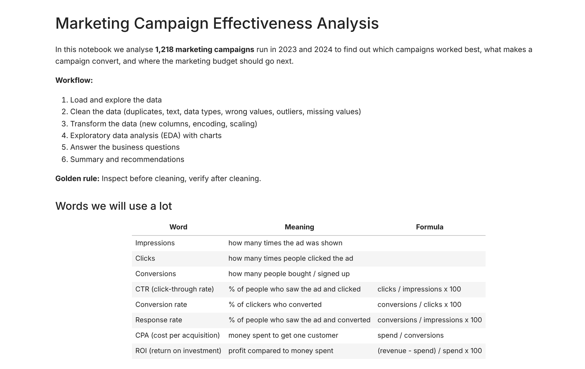

---

## 🔍 Part 1: Campaign Analysis

Notebook: [`marketing-campaign-effectiveness-analysis/Notebooks/marketing_campaign_analysis.ipynb`](marketing-campaign-effectiveness-analysis/Notebooks/marketing_campaign_analysis.ipynb)

### 1. Data Cleaning

**Golden rule:** inspect before cleaning, verify after cleaning. Exploring the raw data found these problems:

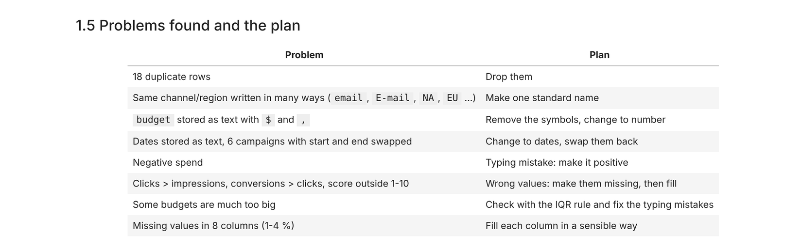

| Problem | How it was fixed |
|---------|------------------|
| 18 duplicate rows | `drop_duplicates()` |
| 31 spellings of 7 channels, 18 spellings of 5 regions | `str.strip().str.lower()` + `replace()` with a mapping dictionary |
| Budget stored as text (`$12,500`) | removed `$` and `,`, then `astype(float)` |
| Dates stored as text, 6 start/end dates swapped | `pd.to_datetime()`, swapped back with `.loc` |
| Negative spend | `abs()` |
| Clicks > impressions, conversions > clicks, score outside 1-10 | set to missing with `.loc`, then filled |
| Budgets with two extra zeros | IQR rule + "budget more than 20x spend" check, divided by 100 |
| Missing values in 8 columns | median of the same channel / region with `groupby().transform("median")`, `"Unknown"` for text |

<details>
<summary><b>📷 Show cleaning screenshots</b></summary>

**Fixing messy channel names**

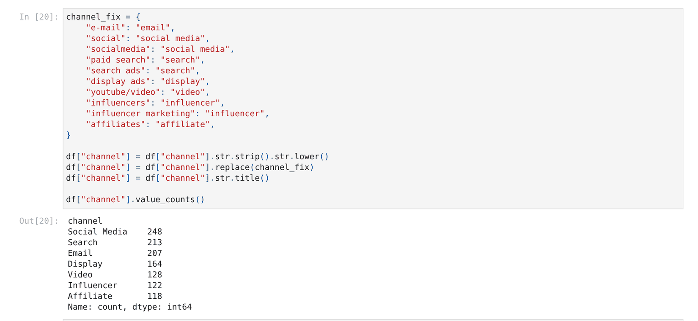

**Filling missing values with the median of the same channel**

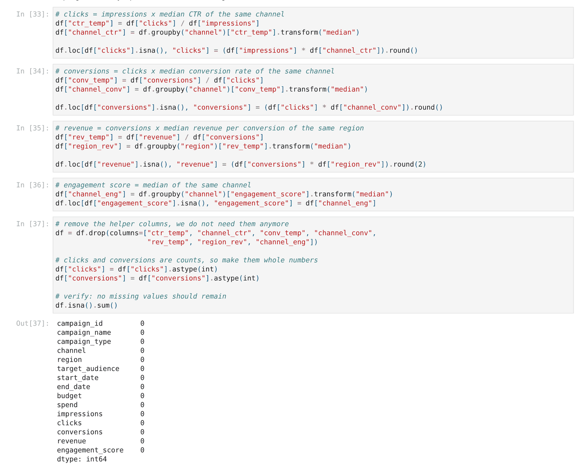

</details>

**Budget outliers before and after fixing the typing mistakes:**

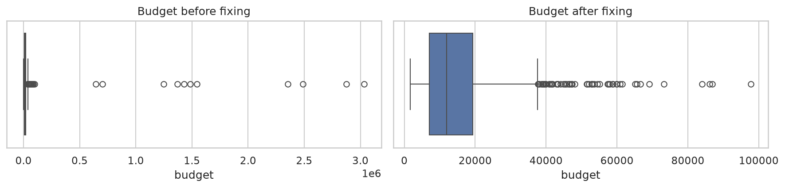

### 2. Transformation

- **New columns:** campaign length, CTR, conversion rate, response rate, CPC, CPA, profit, ROI, year, month, quarter, length group
- **Response-rate outliers:** checked per channel with the IQR rule and **kept**, because they are the real best campaigns
- **Encoding:** one-hot encoding (`pd.get_dummies`) for channel, region, audience and campaign type; label encoding for length group
- **Scaling:** min-max scaling `(value - min) / (max - min)` for spend, impressions and other big numbers

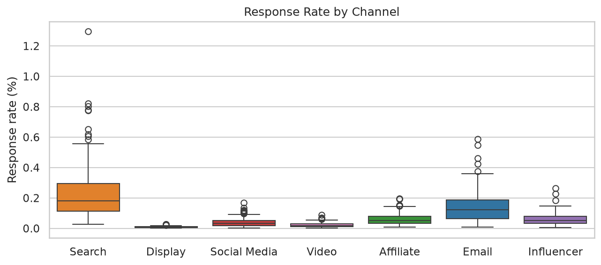

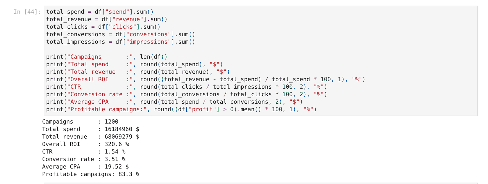

### 3. Visualizations

#### Campaign performance over time
Revenue stays far above spend every month, and ROI is higher in 2024 than in 2023.

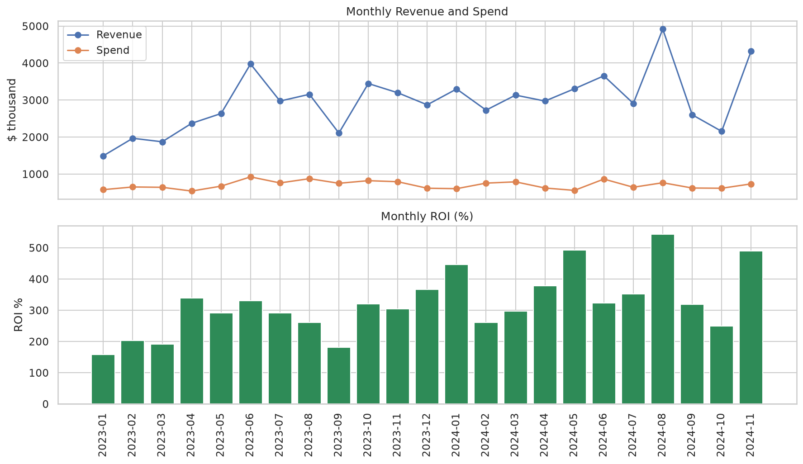

#### Seasonality
Campaigns that start in **November and December** convert best (holiday shopping). 2024 is above 2023 in most months.

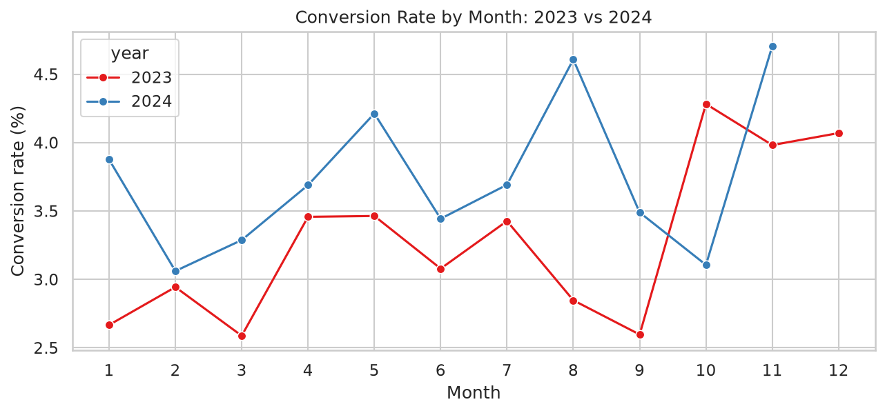

#### Channel comparison
**Email, Search and Affiliate** lead on every measure. **Video and Display** have the most expensive customers and the lowest ROI.

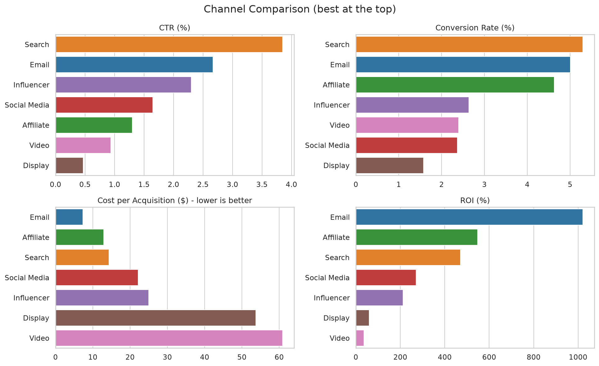

#### ROI of every campaign by channel
Almost every Email, Search and Affiliate campaign makes a profit. About half of Video campaigns fall below the red break-even line.

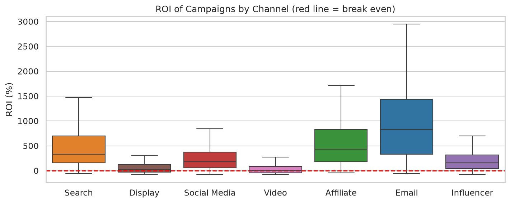

#### Region, campaign type and audience
**North America** gives the best ROI, **Retargeting** converts best, and **Gen Z** gives the lowest ROI.

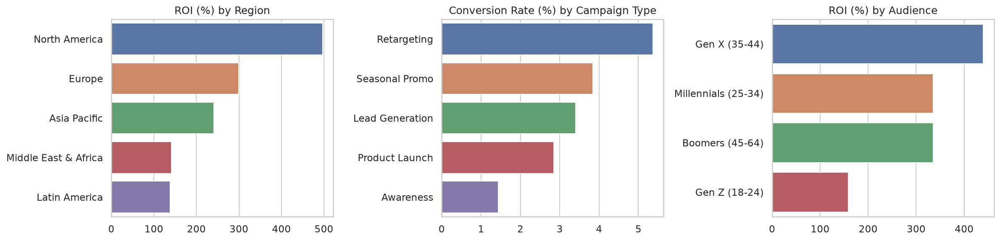

#### Heatmaps: which channel works for whom
Gen Z clicks on **Influencer** and **Social Media**, Boomers on **Email**, Gen X on **Search**.
Video and Display **lose money** in Latin America and Middle East & Africa.

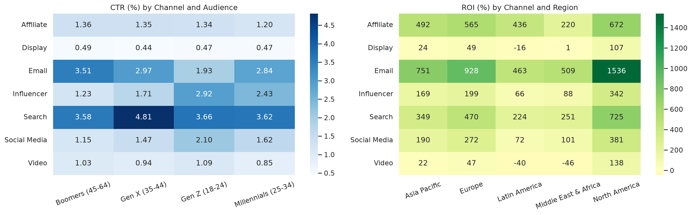

#### Correlation
ROI moves with **conversion rate** (0.71) and against **CPA**. It has almost no relation with how much was spent.

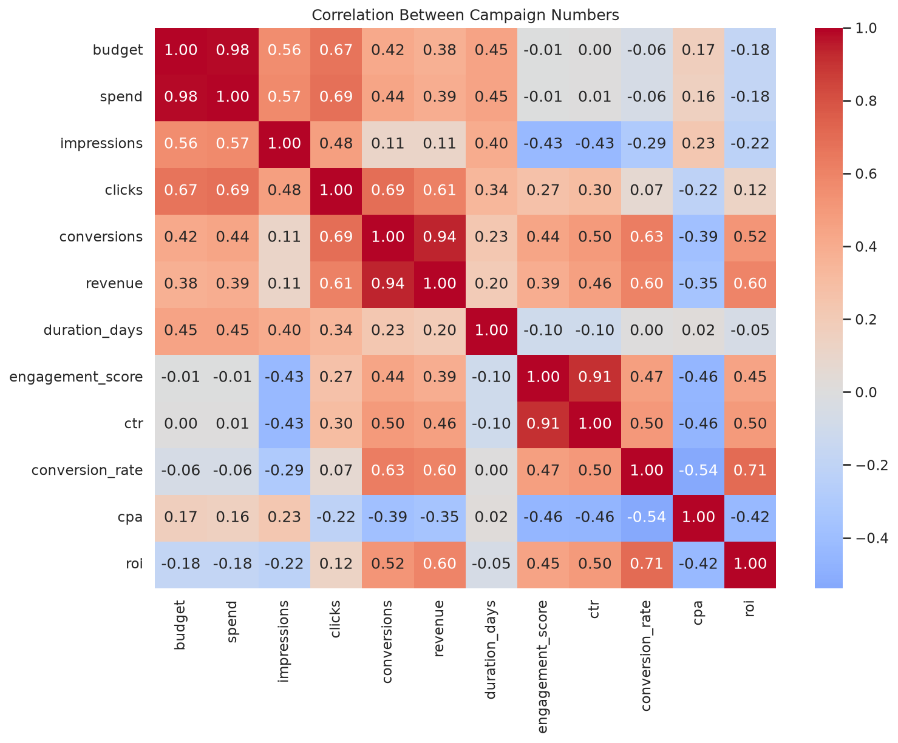

#### Top and bottom campaigns
The top 10 are all Search, Email or Affiliate campaigns, mostly retargeting. The bottom 10 are mostly Video awareness campaigns.

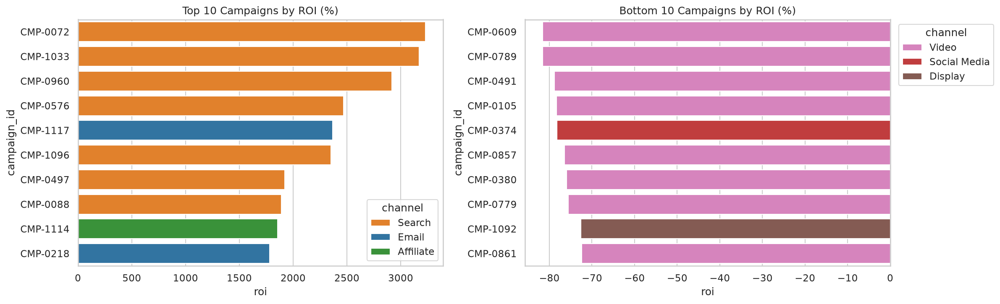

<details>
<summary><b>📷 Show the summary table (one function for every group)</b></summary>

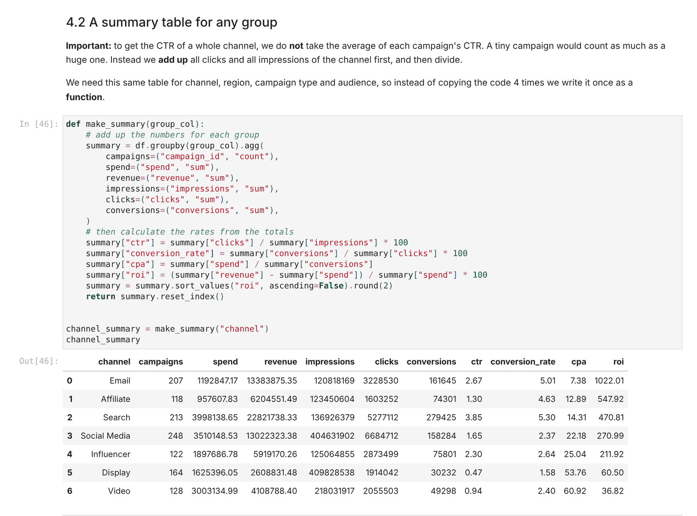

</details>

### 4. Business Questions Answered

| # | Question | Answer |
|---|----------|--------|
| 1 | Which channel gives the best return on the money spent? | **Email**: ROI 1,022 %, one customer costs $7.38 (Video: $60.92) |
| 2 | Which channels take a big part of the budget but bring little profit? | **Video and Display**: 28.6 % of the budget, 4.0 % of the profit |
| 3 | Which campaign type works best, and which one wastes money? | **Retargeting** is best (ROI 632 %). Awareness on Video/Display spent $877K at ROI -44.5 % |
| 4 | Do more clicks mean more sales? | **No.** ROI is linked more to conversion rate (0.71) than to CTR (0.50) |
| 5 | Which audience responds best, and to which channel? | **Gen X** has the best ROI (440 %). Gen Z clicks most but buys least (ROI 158 %) |
| 6 | Which regions perform best and worst? | **North America** best (ROI 497 %, 41 % of revenue). Latin America and MEA weakest |
| 7 | Is there a best time of year to run campaigns? | **Yes**: November (4.34 %) and December (4.07 %) convert best |
| 8 | Do longer campaigns perform better? | **No**: ROI falls from 347 % (1-2 weeks) to 238 % (2+ months) |
| 9 | Did marketing get better from 2023 to 2024? | **Yes**: less spend, more revenue, CPA $21.80 → $17.45, ROI 272 % → 376 % |
| 10 | What do the best and worst campaigns have in common? | Best: Email/Search/Affiliate + retargeting/promo. Worst: Video/Display + awareness |

Every question has its own code cell and a written answer in the notebook:

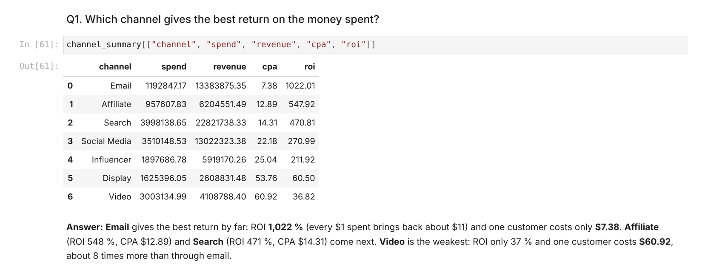

<details>
<summary><b>📷 Show another example (Question 2)</b></summary>

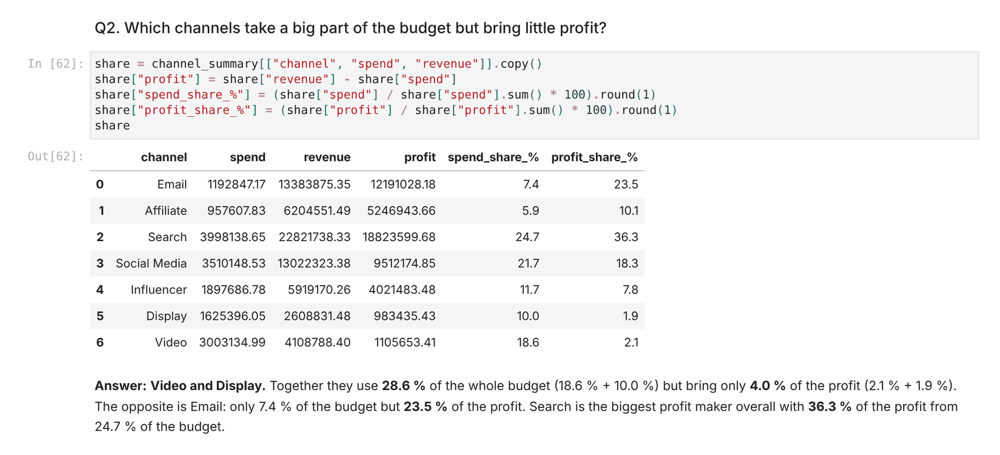

</details>

### 5. Recommendations

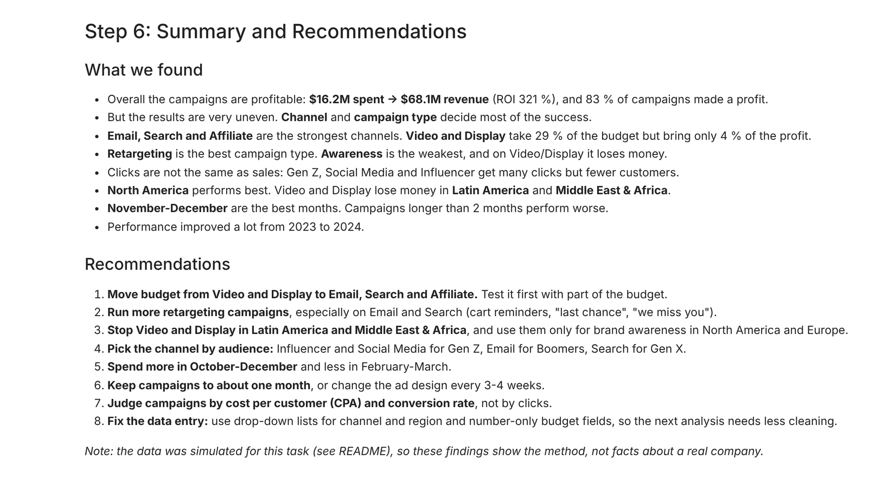

---

## ⚙️ Part 2: Channel x Campaign Type Pipeline

Notebook: [`marketing-campaign-pipeline/Notebooks/channel_type_pipeline.ipynb`](marketing-campaign-pipeline/Notebooks/channel_type_pipeline.ipynb)

This part follows a structured prompt ([`prompt.md`](marketing-campaign-pipeline/prompt.md)): the project
input (goal, columns, grain, known issues, business rules, output) is written down first, and the code
implements the business rules exactly, step by step.

**Goal:** rank every **channel + campaign type** combination by ROI so the marketing manager knows where to put the next budget.

| Step | What happens |
|------|--------------|
| 1. Load and profile | read CSV, shape, types, duplicates, nulls, category spellings |
| 2. Clean | drop duplicates, standardise names, fix negative spend, remove impossible and incomplete rows |
| 3. Transform | group by channel + campaign type, calculate CTR, conversion rate, CPA and ROI from totals |
| 4. Analyze | drop groups with fewer than 10 campaigns, rank by ROI |
| 5. Export and QA | save CSV; row counts per step, null check, duplicate check, spend reconciliation |

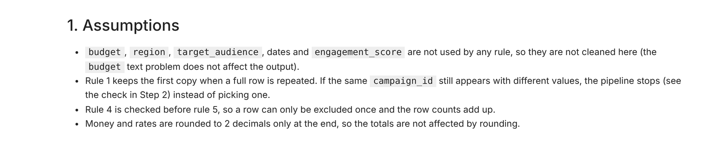

**Result: the best and worst combinations**

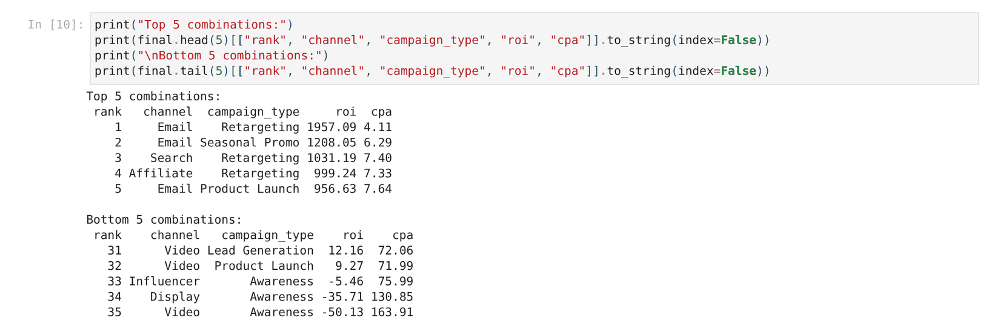

**QA checks:** row counts after every step, no nulls, no duplicates on the grain, and total spend
reconciles with the source to the cent ($16,184,960 - $1,021,261 excluded = $15,163,699).

<details>
<summary><b>📷 Show QA checks and the test</b></summary>

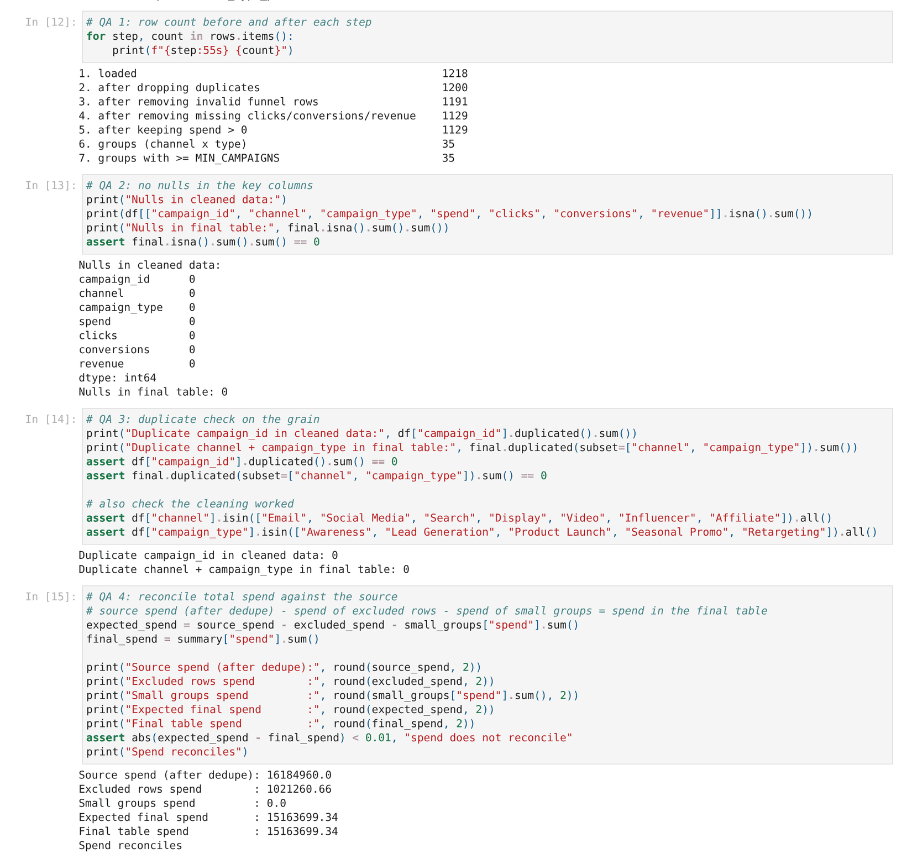

**Test on a 5-row sample with a known expected output:**

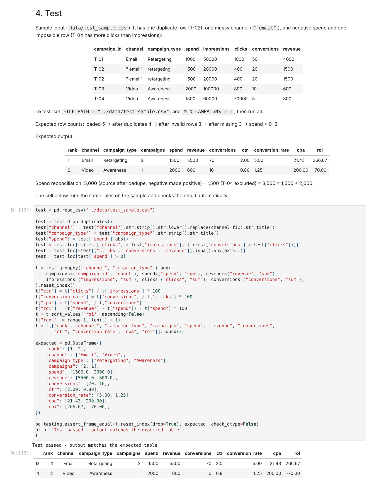

</details>

---

## 🚀 How to Run

```bash
# 1. Clone the repository
git clone https://github.com/<your-username>/<repo-name>.git
cd <repo-name>

# 2. Install the libraries
pip install -r marketing-campaign-effectiveness-analysis/requirements.txt

# 3. Open a notebook (run it from inside its Notebooks/ folder)
cd marketing-campaign-effectiveness-analysis/Notebooks
jupyter notebook marketing_campaign_analysis.ipynb
```

Click **Run All**. The notebook re-creates the clean CSV files and all charts.
For Part 2, open `marketing-campaign-pipeline/Notebooks/channel_type_pipeline.ipynb` the same way.

---

## 🛠️ Tools Used

| Tool | Used for |
|------|----------|
| **Python** | main language |
| **Pandas** | loading, cleaning, `groupby`, pivot tables, encoding |
| **NumPy** | missing values (`np.nan`) |
| **Matplotlib** | subplots, line and bar charts, saving figures |
| **Seaborn** | bar plots, boxplots, heatmaps, line plots |
| **Jupyter Notebook** | step-by-step analysis |
| **Git & GitHub** | version control |

---

> **Note:** the dataset was simulated for this task, so the findings show the analysis method, not facts about a real company.
