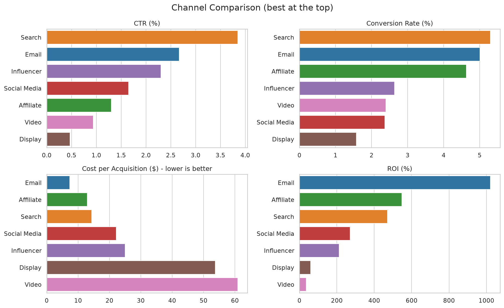

# Marketing Campaign Effectiveness Analysis

A data analysis project on **1,200 marketing campaigns (2023-2024)**: cleaning messy campaign data,
creating performance metrics, exploring the data with charts, and answering business questions about
which campaigns work best and where the budget should go.


---

## 📁 Project Structure

```
marketing-campaign-effectiveness-analysis/
├── Notebooks/
│   └── marketing_campaign_analysis.ipynb   # the full analysis (run top to bottom)
├── data/
│   ├── marketing_campaigns_raw.csv         # original messy data (1,218 rows)
│   ├── marketing_campaigns_clean.csv       # cleaned data + new columns (1,200 rows)
│   └── marketing_campaigns_encoded.csv     # encoded + scaled version, ready for machine learning
├── diagrams/                               # all charts saved by the notebook
├── requirements.txt
└── README.md
```

> The notebook loads data with relative paths like `../data/marketing_campaigns_raw.csv` and saves charts
> to `../diagrams/`, so run it from inside the `Notebooks/` folder.

---

## ⚙️ How to Run

```bash
# 1. Install the libraries
pip install -r requirements.txt

# 2. Open the notebook
cd Notebooks
jupyter notebook marketing_campaign_analysis.ipynb
```

Then click **Run All**. The notebook re-creates the clean CSV files and all charts.

---

## 📊 Dataset

The task did not come with a dataset, so a practice dataset was simulated for it. It copies the
patterns and problems of real campaign data. One row = one campaign.

| Column | Description |
|--------|-------------|
| `campaign_id` | Campaign ID (`CMP-0001` ...) |
| `campaign_name` | Name of the campaign |
| `campaign_type` | Awareness, Lead Generation, Product Launch, Seasonal Promo, Retargeting |
| `channel` | Email, Social Media, Search, Display, Video, Influencer, Affiliate |
| `region` | North America, Europe, Asia Pacific, Latin America, Middle East & Africa |
| `target_audience` | Gen Z, Millennials, Gen X, Boomers |
| `start_date`, `end_date` | When the campaign ran |
| `budget`, `spend` | Planned and real money spent ($) |
| `impressions`, `clicks`, `conversions` | How many saw, clicked and bought |
| `revenue` | Money earned from the campaign ($) |
| `engagement_score` | Score from 1 to 10 |

**Problems in the raw data:** 18 duplicate rows, channel and region names written in many different
ways, budget saved as text (`$12,500`), budgets with two extra zeros, negative spend, more clicks than
impressions, start and end dates swapped, and missing values in 8 columns.

---

## 🧹 What the Notebook Does

| Step | What happens |
|------|--------------|
| 1. Explore | `shape`, `info()`, `describe()`, missing values, duplicates, messy categories, impossible values |
| 2. Clean | drop duplicates, fix text with `str.strip/lower/replace`, fix data types, fix impossible values, IQR rule for budget outliers, fill missing values (median per channel / region with `groupby().transform()`) |
| 3. Transform | new columns (CTR, conversion rate, response rate, CPA, ROI, campaign length, month...), response-rate outliers, one-hot and label encoding, min-max scaling |
| 4. EDA | summary tables by channel / region / campaign type / audience, trends over time, bar charts, boxplots, heatmaps, correlation, top and bottom campaigns |
| 5. Questions | 10 business questions answered with the data |
| 6. Summary | findings and recommendations |

---

## ❓ Questions Answered

| # | Question | Short answer |
|---|----------|--------------|
| 1 | Which channel gives the best return? | **Email**: ROI 1,022 %, $7.38 per customer |
| 2 | Which channels use a lot of budget but bring little profit? | **Video and Display**: 29 % of budget, 4 % of profit |
| 3 | Which campaign type works best / wastes money? | **Retargeting** best (ROI 632 %); awareness on Video/Display lost money (ROI -44 %) |
| 4 | Do more clicks mean more sales? | No. Conversion rate matters more than CTR |
| 5 | Which audience responds best, and to what? | Gen X best ROI; Gen Z likes Influencer/Social, Boomers like Email |
| 6 | Which regions perform best and worst? | North America best; Video loses money in Latin America and Middle East & Africa |
| 7 | Is there a best time of year? | Yes, November-December convert best |
| 8 | Do longer campaigns perform better? | No, ROI drops after one month (ad fatigue) |
| 9 | Did marketing improve from 2023 to 2024? | Yes, less spend, more revenue, ROI 272 % → 376 % |
| 10 | What do the best and worst campaigns have in common? | Best: Email/Search/Affiliate + retargeting. Worst: Video/Display + awareness |



> 📷 Notebook screenshots and all charts with explanations are in the [main README](../README.md).

---

## 💡 Recommendations

1. Move budget from Video and Display to Email, Search and Affiliate (test with part of the budget first).
2. Run more retargeting campaigns on Email and Search.
3. Stop Video and Display in Latin America and Middle East & Africa.
4. Choose the channel by audience: Influencer/Social for Gen Z, Email for Boomers, Search for Gen X.
5. Spend more in October-December.
6. Keep campaigns to about one month, or change the ad every 3-4 weeks.
7. Judge campaigns by cost per customer and conversion rate, not by clicks.

---

## 🛠️ Tools

Python · Pandas · NumPy · Matplotlib · Seaborn · Jupyter · Git/GitHub
